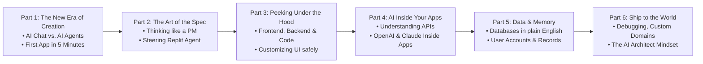

# Zero to Builder: Building Real Apps with AI & Replit

> **A Comprehensive Multi-Part Course for Absolute Beginners**
> *Zero Coding Required. Zero Prior AI Experience Needed.*

---

## 🎯 Course Overview

This course is designed to take complete non-programmers—marketers, designers, product operators, domain specialists, entrepreneurs, and curious creators—and transform them into capable **AI Software Architects**.

Using modern browser-based AI tooling (**Replit** and **Replit Agent**), students learn how software works conceptually, how to direct autonomous AI agents to build full-stack web applications from scratch using natural language, how to connect third-party AI APIs, manage databases, troubleshoot, and deploy live to the internet.

---

## 👥 Who This Course Is For
- **Complete Beginners:** People who have never opened a terminal, written a single line of Python/JavaScript, or used Git.
- **Visual & Conceptual Thinkers:** People who understand business logic, user experience, and workflows, but previously found syntax intimidating.
- **Founders & Idea Generators:** People who want to test, prototype, and ship software without hiring an engineering team upfront.

---

## 🗺️ Course Roadmap

---

## 📁 Repository & Presentation Materials

### 🧑‍🎓 Student Materials (Workbooks & Cheatsheets)
- **[Student Handbook & Lab Workbook](student_workbook.md)**: Session-by-session student guide with 3-minute setup, fill-in C.A.R.E. worksheets, lab checklists, and plain-English tech glossary.
- **[Student Quick-Reference Prompt Cheatsheet](student_prompt_cheatsheet.md)**: Ready-to-copy prompt formulas, 3-part feedback templates, and error debugging prompts for live labs.

### 📊 Instructor & Facilitator Materials
- **[Curriculum Blueprint](curriculum_overview.md)**: Detailed syllabus, pedagogical strategy, and lesson timings.
- **[Live Workshop Facilitator Guide](live_workshop_facilitator_guide.md)**: 90-minute live session arc, chat icebreakers, and "Zero-Stuck Guarantee" triage protocol.
- **PowerPoint Presentation Decks (`.pptx` 16:9 with Presenter Notes):**
  - **[Master Course Deck](presentations/Master_Course_Deck.pptx)** (All 6 modules)
  - Individual session decks located in `presentations/`
- **Module Presentation Guides & Speaker Notes:**
  1. **[Part 1: Demystifying AI Agents & Replit](modules/part-1-demystifying-ai-agents-replit.md)**
  2. **[Part 2: Speaking Agent — Spec-Driven Creation](modules/part-2-speaking-agent-spec-driven-creation.md)**
  3. **[Part 3: Peeking Under the Hood — Software Basics Without Jargon](modules/part-3-peeking-under-the-hood-software-basics.md)**
  4. **[Part 4: Powering Apps with AI Models & APIs](modules/part-4-powering-apps-with-ai-models-apis.md)**
  5. **[Part 5: Databases & Memory — Apps That Remember](modules/part-5-databases-and-memory-apps-that-remember.md)**
  6. **[Part 6: Launching, Debugging & The AI Architect Mindset](modules/part-6-launching-debugging-and-ai-architect-mindset.md)**
