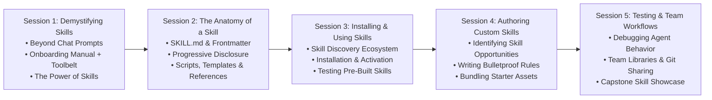

# Supercharging AI Agents with Skills: The Follow-Up Course

> **Course 2: From Prompts to Reusable Superpowers**  
> *Target Audience:* Graduates of "Zero to Builder" and creators who want to transform generalist AI agents into domain-expert powerhouses.  
> *Format:* Live Interactive Workshop (4–5 Sessions) with Native 16:9 PowerPoint Decks & Hands-On Student Lab Manuals.

---

## 🎯 Course Overview

In Course 1 (*Zero to Builder*), students learned how to direct AI agents conversationally to build full-stack web applications. 

In **Course 2: Supercharging AI Agents with Skills**, students level up from basic prompting to **Skill Engineering**. Instead of repeatedly re-typing long prompts or pasting company guidelines every single session, students learn how to equip AI agents with **modular, reusable "Skill Cartridges"**—combining explicit domain instructions (`SKILL.md`), executable automation scripts, templates, and reference materials.

---

## 🗺️ Course Roadmap

---

## 💡 The Core Metaphors

1. **The Intern vs. The Onboarded Specialist:**
   - *Prompting:* Hiring a brilliant temp worker every morning and having to explain the company rules, file formats, and brand guidelines from scratch.
   - *Skills:* Handing that worker a permanent, tailored **Standard Operating Procedure (SOP) binder + toolbelt** on Day 1. The agent reads it automatically whenever the relevant task appears.
2. **The Gaming Console & Game Cartridge:**
   - The AI agent is the gaming console (the raw computing engine).
   - Skills are the game cartridges you plug in (each gives the console a completely new set of levels, rules, and superpowers).
3. **Progressive Disclosure (Lightweight Memory):**
   - Agents don't memorize 1,000 pages of manuals at all times.
   - They see a 2-sentence summary (the index card). Only when the task matches does the agent open the full skill guide.

---

## 📁 Course Repository Structure

- **[Curriculum Blueprint](curriculum_overview.md)**: Syllabus, learning goals, session timing.
- **[Student Handbook & Workbook](student_workbook.md)**: Step-by-step lab worksheets, `SKILL.md` templates, and checklists.
- **[Student Skill Authoring Cheatsheet](student_prompt_cheatsheet.md)**: Copy-paste templates for YAML frontmatter and instructions.
- **Module Presentation Guides & Speaker Notes:**
  - `modules/part-1-demystifying-skills.md`
  - `modules/part-2-anatomy-of-a-skill.md`
  - `modules/part-3-installing-and-using-skills.md`
  - `modules/part-4-authoring-custom-skills.md`
  - `modules/part-5-testing-refining-team-workflows.md`
- **PowerPoint Presentation Decks (`presentations/`):**
  - Native 16:9 `.pptx` presentations with embedded speaker notes for each live workshop session.
