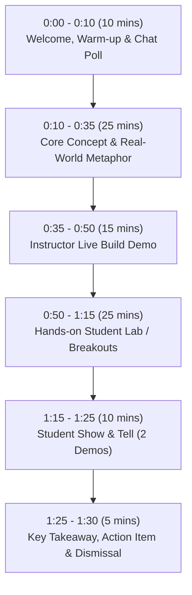

# Live Workshop Facilitator Guide: Zero to Builder with AI & Replit

> **Companion Guide for Live Instructors, Facilitators & Workshop Leaders**  
> *Everything you need to deliver high-energy, zero-stress interactive live sessions.*

---

## ⏱️ The Standard 90-Minute Workshop Session Rhythm

Every live session is designed around this proven instructional arc to maximize retention and keep beginner energy high:

---

## 🛡️ The "Zero-Stuck Guarantee": Real-Time Triage in Live Workshops

When teaching non-coders live, technical anxiety is the #1 obstacle. Here is how to keep 100% of students progressing:

### 1. The "Checkpoint Reset" Rule (Slide into Safety)
- If an agent generates an error loop or unexpected code during a student lab, teach them immediately:
  > *"Don't panic! Click the History icon (Clock) in the top bar of Replit and roll back to the version from 5 minutes ago."*
- This prevents students from getting demoralized.

### 2. The Instructor Backup Template (The Safety Net)
- Before each live workshop, create a working "Starter Repl" in your own account.
- If a student encounters an issue or network delay, paste your backup template link in the chat:
  > *"If your agent got stuck, fork my starter project right here: [link] and continue from Step 2!"*

### 3. Screen-Sharing Protocol
- Never debug student code in isolation while 30 other students watch silently.
- If a student gets stuck, use it as a learning opportunity for the whole group:
  - Ask: *"Who has an error on their screen? Let's fix it together using our 3-step triage."*
  - Have them paste the error into Replit Agent chat. Watch the agent fix it live.

---

## 💬 Live Chat Warm-Ups & Polls by Session

Use these interactive chat prompts during the first 5 minutes while attendees are entering the room:

| Session | Live Chat Prompt / Icebreaker | Goal |
| :--- | :--- | :--- |
| **Session 1** | *"Type in chat: If you had a personal developer sitting next to you right now, what is the #1 tool or website you would ask them to build for you?"* | Sparks creativity and breaks fear. |
| **Session 2** | *"Scale of 1 to 5: How often do you find yourself asking ChatGPT for something and getting an answer that was totally different from what you wanted?"* | Introduces the need for the C.A.R.E. spec framework. |
| **Session 3** | *"Poll: When you hear words like 'frontend', 'backend', or 'server', do you feel: A) Totally confident, B) Kind of get it, or C) Sounds like gibberish?"* | Normalizes non-technical feelings before opening the code editor. |
| **Session 4** | *"Drop in chat: What is one repetitive thinking task at work that drains your soul every week?"* | Prepares them for the internal AI Pitch/Reviewer lab. |
| **Session 5** | *"Think of your favorite app (Spotify, Netflix, Instagram). What is the one thing it remembers about you that makes your life easier?"* | Introduces database persistence naturally. |
| **Session 6** | *"What domain name or app name would you buy today if you knew you could launch it by tonight?"* | Gets them excited for final deployment and custom domains. |

---

## 🎙️ Facilitator Delivery Checklist

### 15 Minutes Before Going Live:
- [ ] Open Replit and log in to a clean, fresh workspace.
- [ ] Have your PowerPoint slides open in Presenter View on your secondary monitor.
- [ ] Prepare your starter prompts in a text notepad (ready to copy-paste during live demo).
- [ ] Start upbeat background music while participants trickle in.

### During the Breakout / Lab (25 Mins):
- [ ] Put a visible 25-minute countdown timer on screen or in chat.
- [ ] Play low-volume focus/ambient music.
- [ ] Encourage students to post their live preview links in the chat as soon as they get their first working screen!
